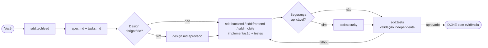

<div align="center">

# Claude SDD Framework

**Spec-Driven Development para o Claude Code: um time de agentes que vai do requisito ao DONE, com evidência.**


[Instalação](docs/instalacao.md) · [Primeiros passos](docs/primeiros-passos.md) · [Como funciona](#como-funciona) · [O time](#o-time) · [Referência](docs/referencia.md) · [Manual de uso](docs/manual-de-uso.html) · [Arquitetura](docs/arquitetura.md)

</div>

---

## O que é

Um **marketplace de plugins do Claude Code** que instala, em qualquer projeto, um processo de engenharia completo:

- **Você conversa com um só agente, o TechLead.** Ele transforma o pedido em spec e tasks, delega aos especialistas e só encerra quando há evidência de que funciona.
- **Nada de implementação sem spec.** Requisito, critério de aceite e forma de validar vêm antes do código.
- **Agnóstico de linguagem.** A stack do projeto é declarada no `CLAUDE.md`; o conhecimento específico vem de referências (.NET, Python, React, Angular; infra: AWS, Azure, Google Cloud).
- **Segurança e qualidade embutidas.** Revisão de segurança, validação independente e regras que nenhum projeto pode relaxar (segredos, SSL, ações irreversíveis, menor privilégio). **O merge de PR é sempre seu.**

## Instalar

Escolha a sua situação e siga o passo a passo em **[docs/instalacao.md](docs/instalacao.md)**:

| | Situação | Começa em |
|---|---|---|
| **A** | Não tenho o Claude Code instalado | [instalar o CLI, logar, git](docs/instalacao.md#a-máquina-sem-claude-code) |
| **B** | Projeto novo, pasta vazia | [B. Projeto novo](docs/instalacao.md#b-projeto-novo-pasta-vazia) |
| **C** | Projeto com código existente | [C. Código existente](docs/instalacao.md#c-projeto-com-código-existente) |
| **D** | Um colega já configurou o projeto | [D. Já usa o sdd](docs/instalacao.md#d-projeto-que-já-usa-o-sdd) |
| **E** | Já instalado, quero trocar de versão | [E. Atualizar](docs/instalacao.md#e-atualizar-a-versão) |
| **F** | Mexo no framework | [F. Clone local](docs/instalacao.md#f-clone-local-quem-mexe-no-framework) |

O caso mais comum (C, com o Claude Code **2.1.288 ou superior** já instalado), na raiz do repositório:

```bash
claude plugin marketplace add "https://github.com/powerlok/claude-sdd-framework.git#v0.12.0"   # 1x por máquina
mkdir -p .claude && curl -fsSL https://raw.githubusercontent.com/powerlok/claude-sdd-framework/v0.12.0/templates/project-settings.git.json -o .claude/settings.json
claude plugin install sdd@claude-sdd-framework --scope project
claude          # aceite a confiança da pasta e digite /sdd:start
```

Já tem `.claude/settings.json`? Mescle em vez de sobrescrever (veja o [tipo C](docs/instalacao.md#c-projeto-com-código-existente)). No Windows, use o Git Bash para estes comandos.

**Não sabe o que falta?** O verificador (somente leitura) diz o tipo do projeto, o que falta e o próximo passo: `bash scripts/check-env.sh` (macOS, Linux, Git Bash) ou `scripts\check-env.ps1` (Windows PowerShell).

## Como funciona



Estados de cada task: `TODO → IN_PROGRESS → IMPLEMENTED → SECURITY_REVIEW → VALIDATING → DONE`. **Só o TechLead encerra.**
Ao concluir uma spec, o TechLead abre o PR e entrega a URL; revisar e fazer o merge é com você.

## O time

| Agente | Papel | Modelo |
|---|---|---|
| `sdd:techlead` | Orquestra, cria specs e tasks, aprova design, encerra (sessão principal) | opus |
| `sdd:backend` | APIs, domínio, persistência e testes, na stack do projeto | sonnet |
| `sdd:frontend` | Interfaces, UX, acessibilidade e testes; confere a tela no navegador (Playwright) | sonnet |
| `sdd:mobile` | Apps mobile (React Native/Expo), acessibilidade, permissões e testes | sonnet |
| `sdd:tests` | Validação independente: regressão, contratos, E2E, aceite | sonnet |
| `sdd:security` | Revisão de segurança (AppSec, dependências, segredos), somente leitura | opus |
| `sdd:infra-architect` | Arquitetura de nuvem (AWS, Azure, Google Cloud) e diagramas (draw.io); nunca aplica mudança | opus |

Comandos: `/sdd:start` (inicia o fluxo), `/sdd:publish` (modo publicação), `/sdd:office` (salinha dos agentes), `/sdd:git-lang` (idioma de commits). Skills e detalhes: [referência](docs/referencia.md#skills).

## Segurança em uma olhada

- O `templates/project-settings.git.json` **bloqueia** (`deny`) só o que não deve acontecer: merge de PR, token do `gh`, leitura de segredos (`.env`, chaves, `~/.ssh`...). Git, escrita em sistemas externos (issues, Jira, GitLab, Azure DevOps) e nuvem (`az`, `aws`, `gcloud`) **perguntam a cada comando** (`ask`).
- O hook `merge-guard` do plugin bloqueia merge e push forçado em qualquer modo de permissão, até dentro de `sh -c`.
- Limites e detalhes: [Proteções do template](docs/referencia.md#proteções-do-template).

## Documentação

| Documento | Para quê |
|---|---|
| [Instalação](docs/instalacao.md) | Instalar por tipo de situação (A a F), do CLI ao `/sdd:start` |
| [Primeiros passos](docs/primeiros-passos.md) | Depois de instalar: primeira conversa, primeiro pedido, equipe |
| [Referência](docs/referencia.md) | Proteções, camadas do `CLAUDE.md`, salinha, contexto, MCPs, Jira, desenvolvimento |
| [Manual de uso](docs/manual-de-uso.html) | 18 exemplos passo a passo (abra no navegador, funciona offline) |
| [Arquitetura](docs/arquitetura.md) | Componentes, hooks, carregamento de skills e segurança |
| [CHANGELOG](CHANGELOG.md) · [`.specs/INDEX.md`](.specs/INDEX.md) | Histórico de versões · specs do framework |

## Licença e créditos

[MIT](LICENSE). Material de terceiros em `plugins/authoring/skills/skill-development/references/` segue a Apache-2.0.
`frontend-engineering` adapta *frontend-design* (Anthropic, Apache-2.0); métodos inspirados (texto próprio) em
[mattpocock/skills](https://github.com/mattpocock/skills), [obra/superpowers](https://github.com/obra/superpowers) e
[vercel-labs/web-interface-guidelines](https://github.com/vercel-labs/web-interface-guidelines) (MIT).

---

<sub>Projeto da comunidade, **não afiliado à Anthropic**. "Claude" e "Claude Code" são marcas da Anthropic, PBC.</sub>
