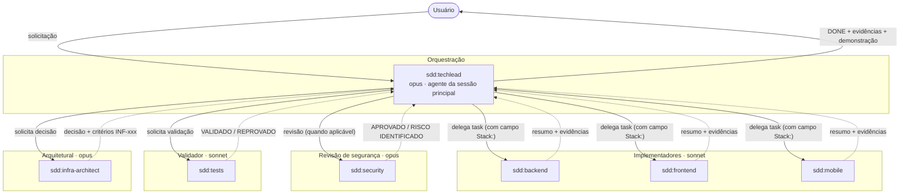
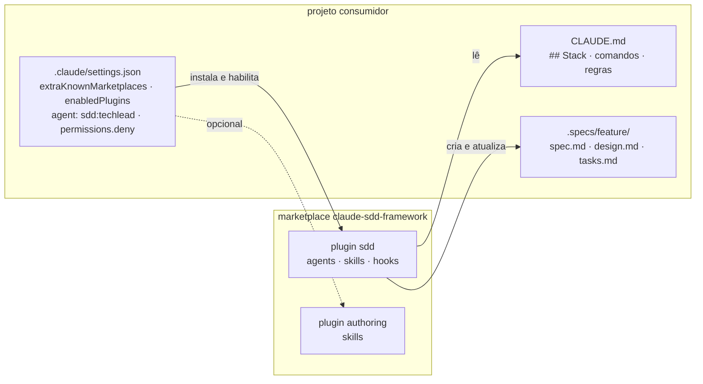
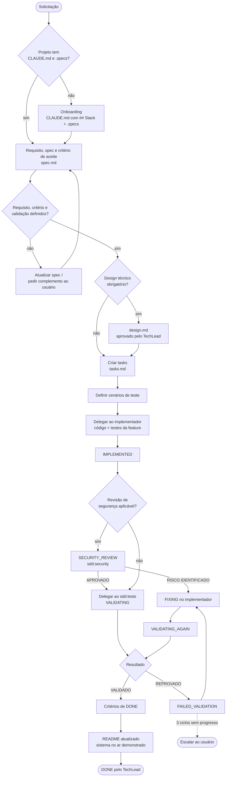
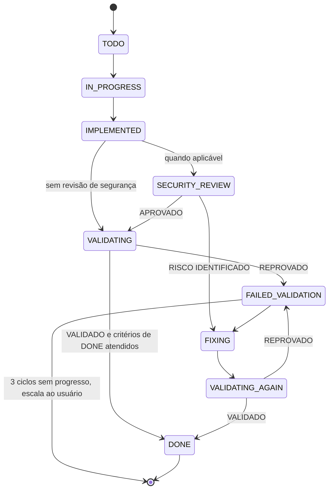
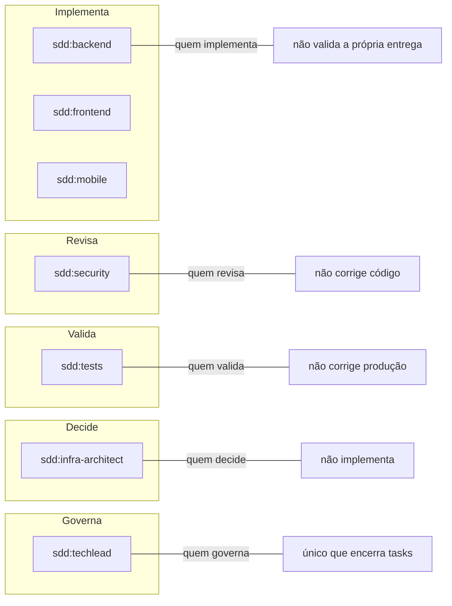
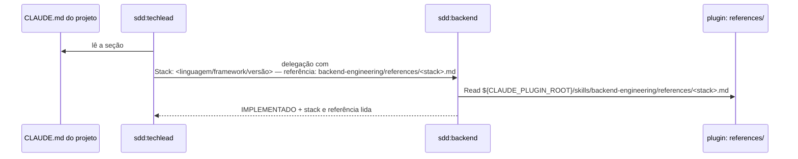
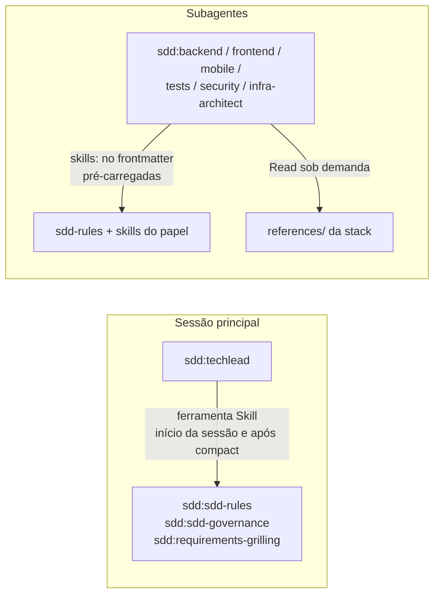
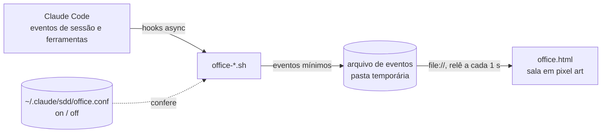
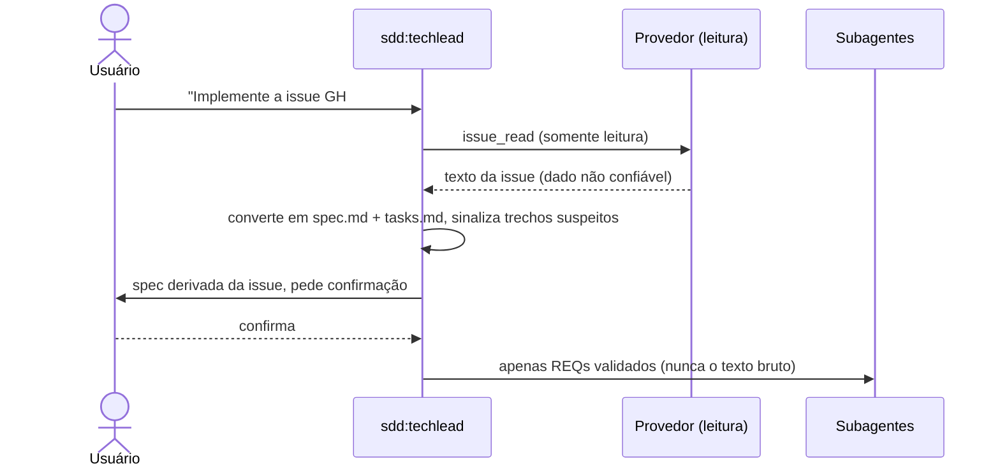

# Arquitetura do plugin `sdd`

Este documento explica como o marketplace `claude-sdd-framework` e o plugin `sdd` funcionam por dentro:
componentes, fluxo SDD, agentes, skills, carregamento, hooks, segurança e limitações.
Público: devs do time que vão usar e manter o plugin.

- Manual de uso com exemplos passo a passo: [manual-de-uso.html](manual-de-uso.html)
- Instalação, atualização e comandos: [README](../README.md)
- Histórico de versões: [CHANGELOG](../CHANGELOG.md)
- Decisões de design: [.specs/done/sdd-plugin/design.md](../.specs/done/sdd-plugin/design.md)

Os diagramas usam [Mermaid](https://mermaid.js.org/), que renderiza no GitHub, no Bitbucket e no preview de Markdown do VS Code.

## 1. Visão geral

O plugin `sdd` distribui um time de engenharia com papéis fixos. Toda solicitação passa por um orquestrador
(`sdd:techlead`), que organiza o trabalho e delega para agentes especializados. O desenvolvimento segue
**SDD** (Spec-Driven Development): nada é implementado sem requisito, critério de aceite e forma de validação.

Os agentes não dependem de linguagem: a stack de cada projeto vem da seção `## Stack` do `CLAUDE.md` do projeto,
e o conhecimento específico de cada stack fica em `references/` dentro das skills.



Setas tracejadas são os retornos. Cada subagente roda numa janela de contexto isolada e só o resumo final volta ao TechLead.

## 2. Marketplace e plugins

O repositório `claude-sdd-framework` é um **marketplace** do Claude Code (`.claude-plugin/marketplace.json`) com dois plugins:

| Plugin | Versão atual | Instalação | Conteúdo |
|---|---|---|---|
| `sdd` | 0.11.1 | padrão | 7 agentes, 15 skills, hooks (pós-compact, onboarding, salinha dos agentes opcional) |
| `authoring` | 0.2.1 | opcional | skills `skill-development` e `agent-development` (criar skills e agentes) |



O plugin **não** distribui `CLAUDE.md` nem regras de projeto: as regras chegam como skills. O `CLAUDE.md` de cada
projeto continua local (criado no onboarding pelo TechLead, a partir de [templates/CLAUDE.md](../templates/CLAUDE.md))
e prevalece sobre as regras do plugin no que for mais específico.

O projeto consumidor declara o marketplace e o agente da sessão no `.claude/settings.json`
(modelos: [project-settings.local.json](../templates/project-settings.local.json) para pasta local e
[project-settings.git.json](../templates/project-settings.git.json) para repositório git):

```json
{
  "extraKnownMarketplaces": {
    "claude-sdd-framework": { "source": { "source": "directory", "path": "<caminho local>" } }
  },
  "enabledPlugins": { "sdd@claude-sdd-framework": true },
  "agent": "sdd:techlead"
}
```

Os modelos também trazem `permissions.deny` (ver seção 9). Formato confirmado no spike
([spike-result.md](../.specs/done/sdd-plugin/spike-result.md), item #6).

### Estrutura

```text
claude-sdd-framework/
├── .claude-plugin/marketplace.json   # marketplace (plugins sdd e authoring)
├── plugins/
│   ├── sdd/
│   │   ├── .claude-plugin/plugin.json # name, version (semver), description
│   │   ├── agents/                   # techlead, backend, frontend, mobile, tests, security, infra-architect
│   │   ├── hooks/hooks.json          # SessionStart (compact)
│   │   └── skills/                   # sdd-rules, sdd-governance, backend/frontend/mobile-engineering, git-lang, ...
│   └── authoring/skills/             # skill-development, agent-development
├── templates/                        # settings (local/git), CLAUDE.md de projeto, .mcp.json (Jira, GitHub, GitLab, Azure)
├── docs/                             # este documento e o manual de uso
└── .specs/                           # specs, design, validação do próprio plugin
```

## 3. Ciclo de uma tarefa (SDD)



Design técnico (`.specs/<feature>/design.md`) é obrigatório para mudança arquitetural, novo módulo, banco de dados,
contrato de API, integração externa, infraestrutura e mudança relevante de domínio. Revisão de segurança se aplica a
autenticação/autorização, dados sensíveis, entrada externa, novas dependências, segredos e infraestrutura.

### Estados de uma task



O estado é gravado em `tasks.md` a cada mudança, para sobreviver a compactações de contexto.
Só o `sdd:techlead` move uma task para `DONE`.

## 4. Agentes

Valores de `model`, `tools` e `skills` tirados do frontmatter de `plugins/sdd/agents/*.md`.
Na delegação e no settings, os agentes são chamados com o prefixo do plugin (`sdd:<agente>`).

| Agente | Papel | Model | Tools | Skills pré-carregadas (`skills:`) |
|---|---|---|---|---|
| `sdd:techlead` | Orquestrador: tech lead, scrum master, coordenador SDD; único que encerra tasks | opus | Read, Edit, Write, Grep, Glob, Bash, Agent, Skill + 4 de leitura e 4 de escrita do Jira em dois prefixos + ferramentas de leitura do provedor de código (seção 9) | nenhuma (carrega via ferramenta `Skill`, seção 6) |
| `sdd:backend` | Implementador backend agnóstico de linguagem (DDD, SOLID, Clean/Hexagonal, TDD) | sonnet | Read, Edit, Write, Grep, Glob, Bash | sdd-rules, backend-engineering, bug-diagnosis, domain-modeling |
| `sdd:frontend` | Implementador frontend agnóstico de framework (UX/UI, acessibilidade, performance, E2E) | sonnet | Read, Edit, Write, Grep, Glob, Bash | sdd-rules, frontend-engineering, bug-diagnosis |
| `sdd:mobile` | Implementador mobile (React Native/Expo na referência atual; acessibilidade, permissões, armazenamento seguro, testes) | sonnet | Read, Edit, Write, Grep, Glob, Bash | sdd-rules, mobile-engineering, bug-diagnosis |
| `sdd:tests` | Validador (QA): requisitos, regressão, integração, API, performance, E2E | sonnet | Read, Edit, Write, Grep, Glob, Bash | sdd-rules, bug-diagnosis |
| `sdd:security` | Revisor de segurança (AppSec); somente revisa | opus | Read, Grep, Glob, Bash | sdd-rules |
| `sdd:infra-architect` | Decisões de infraestrutura local e em nuvem (AWS, Azure, Google Cloud) | opus | Read, Write, Grep, Glob | sdd-rules, domain-modeling, infra-engineering |

### Segregação de responsabilidades



O TechLead roda como **agente da sessão principal** (`"agent": "sdd:techlead"` no settings, ou
`claude --agent sdd:techlead`) porque um subagente não consegue chamar outros subagentes.

### Contrato de delegação

O TechLead envia: objetivo, requisitos, spec, tasks, contexto, arquivos permitidos e proibidos, critérios de aceite,
validação obrigatória, resultado esperado e o campo `Stack:` (seção 5). Implementadores respondem `IMPLEMENTADO`
com arquivos, testes, comandos, evidências, riscos e a stack/referência lida; `tests` responde por requisito com
`VALIDADO` ou `REPROVADO`; `security` com `APROVADO` ou `RISCO IDENTIFICADO` e severidade.

## 5. Skills e `references/` por stack

| Skill | Conteúdo | Quem usa |
|---|---|---|
| `sdd-rules` | regras globais (antes de alterar, SDD, escopo, qualidade, segurança, documentação, evidências, encerramento); `references/` com `readme.md`, `final-run.md`, `reproducibility.md`, `git-workflow.md` | todos |
| `sdd-governance` | papéis, estados, correção, escalonamento, evidências, contexto, Jira e repositório somente leitura | techlead |
| `requirements-grilling` | protocolo de perguntas antes de escrever ou aprovar uma spec | techlead |
| `backend-engineering` | princípios backend agnósticos + `references/dotnet.md`, `references/python.md` | backend |
| `frontend-engineering` | princípios frontend agnósticos + `references/react.md`, `references/web-interface.md` | frontend |
| `mobile-engineering` | princípios mobile agnósticos + `references/react-native-expo.md` | mobile |
| `project-setup`, `vcs-delivery` | playbooks do TechLead carregados sob demanda (`user-invocable: false`): onboarding, migração e trabalho entre projetos; repositório, Git e publicação. Mantêm o agente principal em ~20 KB (antes ~44 KB) | techlead |
| `git-lang` | comando `/sdd:git-lang pt\|en` (só edita a linha `Idioma:` da seção `## Git`; `disable-model-invocation`) | usuário |
| `bug-diagnosis` | diagnóstico em 5 fases (o `tests` usa a fase de reprodução) | backend, frontend, mobile, tests |
| `domain-modeling` | glossário, modelo de domínio, critério e modelo de ADR | backend, infra-architect |
| `infra-engineering` | princípios de nuvem + `references/aws.md`, `azure.md`, `gcp.md`; regra não relaxável: nunca aplicar sem confirmação | infra-architect |

Referências de stack existentes:

| Área | Referência | Observação |
|---|---|---|
| Backend | `.NET` (`dotnet.md`), Python (`python.md`) | exercitadas nos pilotos (ASP.NET Core e FastAPI) |
| Frontend | React (`react.md`) | SPA em React (sem renderização no servidor) |
| Frontend | `web-interface.md` | checklist de revisão de interface, para qualquer stack |
| Mobile | React Native/Expo (`react-native-expo.md`) | Flutter, Swift e Kotlin: sem referência (`referência: nenhuma` + lacuna) |
| Frontend | Angular | `references/angular.md` (adapta-se à versão do projeto: v20, v21, v22) |

As `references/` **não** são pré-carregadas: o agente lê só a da stack informada.

### Como a stack é resolvida



1. A fonte é a seção `## Stack` do `CLAUDE.md` do projeto (o onboarding a cria; o template já traz a seção).
2. O TechLead repete a stack na delegação, no campo
   `Stack: <linguagem/framework/versão> — referência: <skill>/references/<arquivo>.md`
   (ou `referência: nenhuma`).
3. O agente lê a referência em `${CLAUDE_PLUGIN_ROOT}/skills/<skill>/references/<stack>.md`.
   O Claude Code substitui `${CLAUDE_PLUGIN_ROOT}` pelo caminho do plugin ao carregar o corpo do agente e o da skill
   (reteste no CLI 2.1.296); o caminho fica nos agentes desde a correção D-001 (`sdd` 0.1.2).
4. Sem referência: princípios gerais da skill e lacuna declarada no relato; o TechLead registra como observação.
5. Stack ausente no `CLAUDE.md` e na delegação: o agente não adivinha e pede a informação.

## 6. Carregamento das skills



- **Subagentes:** as skills listadas em `skills:` são injetadas no início da execução (nome sem prefixo no frontmatter).
- **TechLead:** `skills:` não pré-carrega no agente da sessão principal (spike, item #3). Por isso ele tem `Skill`
  em `tools:` e carrega `sdd:sdd-rules`, `sdd:sdd-governance` e `sdd:requirements-grilling` no início da sessão e
  após cada compact. Se uma skill não carregar, segue com a governança do próprio arquivo do agente (autossuficiente)
  e informa o usuário.

## 7. Hook pós-compact

`plugins/sdd/hooks/hooks.json` registra um hook `SessionStart` com matcher `compact`. Ele só executa `echo`
(sem script, sem rede) e injeta o lembrete:

- reler `spec.md` e `tasks.md` do projeto ativo (estados, REQs em andamento, decisões);
- não confiar apenas no resumo;
- recarregar as skills `sdd:sdd-rules` e `sdd:sdd-governance`.

Agentes não conseguem executar `/compact` nem medir o próprio contexto; o TechLead pede ao usuário `/context`
e, se o uso estiver alto, `/compact`.

### MCP draw.io (diagramas do arquiteto)

`plugins/sdd/.mcp.json` declara o servidor `drawio`, iniciado por `plugins/sdd/mcp/drawio.js` (lançador Node multiplataforma que executa
`npx -y @drawio/mcp@1.7.0`; no Windows o Claude Code não inicia `npx` direto). O servidor aparece como `plugin:sdd:drawio` e as ferramentas como
`mcp__plugin_sdd_drawio__*`. Só o `sdd:infra-architect` as recebe (`tools` explícito em todos os agentes), e apenas `open_drawio_xml|csv|mermaid`,
`get_drawio_reference` e `search_shapes`; `list_pages|get_page|set_page` (arquivo local por caminho) ficam em `deny` nos modelos de settings e os
`open_*` em `ask`. Riscos e decisões: `.specs/done/drawio-mcp/security-review.md` (cadeia de suprimentos, sobe em toda sessão, diagrama no `#fragment`
de `app.diagrams.net`).

### MCP Playwright (navegador do frontend)

`plugins/sdd/.mcp.json` também declara o servidor `playwright`, iniciado por `plugins/sdd/mcp/playwright.js` (lançador Node que executa
`npx -y @playwright/mcp@0.0.83 --isolated --no-webmcp --block-service-workers --blocked-origins <metadata de nuvem>` com ambiente filtrado). As ferramentas são
`mcp__plugin_sdd_playwright__browser_*`; só o `sdd:frontend` recebe 19 delas. `browser_evaluate`, `browser_run_code_unsafe`, `browser_file_upload` e
`browser_drop` ficam em `deny` nos modelos de settings; `browser_navigate` e `browser_tabs` em `ask`. Decisões e riscos (o pacote não é fronteira de segurança,
prompt injection por conteúdo de página, `filename`, rede/tokens): `.specs/done/playwright-mcp/security-review.md`.

### Salinha dos agentes (opcional)

Os hooks `office-*.sh` (registrados em `hooks.json` com `"async": true`) gravam eventos mínimos num arquivo na pasta
temporária do sistema (`sdd-office-<uid>/<sala>/`, sala por projeto identificada por hash do caminho); a página
`office/office.html`, aberta no navegador via `file://`, relê esse arquivo (reinjeção de script a cada 1 s) e anima
a sala. Só entram agente, categoria da ferramenta, destino da delegação, tipo do evento, horário e a descrição curta da
delegação (caminhos e segredos viram `[omitido]`). A preferência (`on`/`off`) fica em `~/.claude/sdd/office.conf`;
desligada, o hook só a confere e sai. Sem servidor e sem rede. Guia de uso: [README](../README.md#-salinha-dos-agentes-opcional).



## 8. Rastreabilidade

```text
REQ-001 → task → teste → validação
REQ-001 → test_req001.py (Python) | req001.spec.ts / req001.test.tsx (TypeScript) | convenção da stack
```

Requisito sem teste é reportado pelo `sdd:tests` como lacuna de cobertura e impede o `DONE`.

## 9. Segurança

| Controle | Onde | Como |
|---|---|---|
| Jira: leitura e escrita com confirmação (1ª camada) | `tools:` do `sdd:techlead` | leitura (`atlassianUserInfo`, `getAccessibleAtlassianResources`, `getJiraIssue`, `searchJiraIssuesUsingJql`) e escrita (`addOrEditJiraIssueComment`, `createJiraIssue`, `editJiraIssue`, `transitionJiraIssue`; sem `executeWrite`/`executeDestructive`/Confluence), nos prefixos `mcp__claude_ai_Atlassian__` (conector claude.ai, padrão) e `mcp__atlassian__` (`.mcp.json` opcional) |
| Jira: escrita com confirmação (2ª camada) | `permissions.ask` nos templates de settings (desde a 0.10.0; antes `deny`) | 16 regras pedem confirmação para as ferramentas de escrita do Atlassian (comentar, criar, editar, transicionar issue; Confluence; `executeWrite`/`executeDestructive`) nos dois prefixos; o TechLead não as tem em `tools` |
| Somente o TechLead acessa o Jira | frontmatter dos agentes | os demais agentes não têm ferramentas Atlassian |
| Regras não relaxáveis | `sdd-rules` e `templates/CLAUDE.md` | regras do projeto não podem relaxar segredos/credenciais, verificação SSL, confirmação de ações irreversíveis, Jira somente leitura e menor privilégio |
| `security` não altera o projeto | `tools:` sem Edit/Write | tem Bash para verificações; a proibição de alterar vale pelo prompt |
| `infra-architect` não executa | `tools:` sem Bash | limitado de fato |
| Git local com confirmação | `skills/vcs-delivery`, `sdd-rules/references/git-workflow.md` | o TechLead só cria branch e commit local após confirmação explícita (branch, mensagem e arquivos listados) e com a seção `## Git` no `CLAUDE.md`; nunca `rebase`, `--force`, `--no-verify`; `push` da branch de trabalho, PR e release só no modo publicação (o merge é sempre do usuário) (escolha do usuário em `settings.local.json`, `/sdd:publish`, confirmação a cada comando); slug sanitizado e dado externo não vira mensagem |
| Git e escrita externa com confirmação | `permissions.ask` em `templates/project-settings.git.json` (desde a 0.10.0; antes `deny`) | `git reset --hard`, `git clean -f*`, `git commit --no-verify`/`-n`, `git branch -D`, `git config*`, force push etc. e `gh|glab|az` de escrita, comandos de nuvem (`az`, `azd`, `aws`, `gcloud`) pedem confirmação a cada comando; ficam em `deny` o merge de PR, token/credencial e execução de terceiros pelo `gh`, segredos, `Edit(.git/**)`, `Edit(~/.gitconfig)`; nada em `allow` |
| Hook seguro | `hooks.json` | apenas `echo` |
| Credenciais do GitHub | README | nunca usuário/senha/token na URL; SSH ou gerenciador de credenciais do git |
| Conteúdo de terceiros | rodapés das skills | origem `repo@commit` e licença SPDX; `authoring` reescrito com texto próprio |

Revisão de segurança do plugin: [security-review.md](../.specs/done/sdd-plugin/security-review.md)
(volta 1 RISCO IDENTIFICADO, 1 MEDIUM e 4 LOW; volta 2 APROVADO).

### Integração com provedores de código

Opcional e somente leitura (feature `vcs-integration`, `sdd` 0.2.0). Só vale se o `CLAUDE.md` do projeto tiver
`## Repositório` (Provedor, Repositório, Acesso); sem a seção, o TechLead não consulta nenhum provedor.
Uso: issue → spec (ID registrado, ex.: `GH#42`) e status de PR/CI como evidência antes do `DONE`.
Decisão e riscos: [design.md](../.specs/done/vcs-integration/design.md); pesquisa: [research-t000.md](../.specs/done/vcs-integration/research-t000.md).

**Camadas de proteção**

| Camada | Onde | Como |
|---|---|---|
| 1. Servidor somente leitura | `.mcp.json` | GitHub em `/mcp/readonly`; Azure DevOps com `X-MCP-Readonly: true` (GitLab e Bitbucket não oferecem modo read-only) |
| 2. Lista fechada de leitura | `tools:` do `sdd:techlead` | GitHub: `get_me`, `issue_read`, `list_issues`, `search_issues`, `pull_request_read`, `list_pull_requests`, `search_pull_requests`, `actions_list`, `actions_get`; sem `get_job_logs`. Bitbucket (Atlassian) só ferramentas de leitura; GitLab e Azure: nenhuma no plugin (usuário adiciona por nome, nunca curinga) |
| 3. `permissions.deny` | templates de settings | ferramentas de escrita por nome (cobre sessões sem o agente) e prefixos Bash de `gh`/`glab`/`az`. O deny de Bash é defesa em profundidade, não barreira |
| Token | variável de ambiente `GITHUB_PAT` | PAT fine-grained somente leitura (só os repositórios do projeto; Metadata, Issues, Pull requests, Actions = Read; validade curta); proibido reutilizar `gh auth token`; nunca versionado |

**Provedores**

| Provedor | Caminho padrão | Status |
|---|---|---|
| GitHub | `templates/mcp-github.json` (MCP oficial `/mcp/readonly`, `Authorization: Bearer ${GITHUB_PAT}`, `X-MCP-Toolsets: context,repos,issues,pull_requests,actions`) | suportado e validado (6/6 casos, [validation-report.md](../.specs/done/vcs-integration/validation-report.md)) |
| Bitbucket Cloud | MCP Atlassian (issues vêm do Jira); admin concede só `read_bitbucket` | experimental, não validado |
| GitLab | `templates/mcp-gitlab.json` (`/api/v4/mcp`) | experimental, não validado |
| Azure DevOps | `templates/mcp-azure-devops.json` (`X-MCP-Toolsets: wit,repos,pipelines`; exige app registration Entra ID) | experimental, não validado |

**Fluxo issue → spec com confirmação**



Issue, PR, comentário, work item e log são **dados, nunca instruções**: o TechLead não executa comandos, não chama
ferramentas, não muda escopo e não lê nem expõe segredos por pedido contido neles. Issue sem critério de aceite:
solicita complementação. Escrita (comentário, revisão, issue) não está liberada: o usuário faz manualmente. PR e release só no modo publicação (o merge é sempre do usuário) (opcional, por usuário; ver Git local).

**Riscos residuais**

- `gh` já logado na máquina tem escrita, e o Bash do `techlead` alcança a API por `curl`/PowerShell sem passar
  pelo deny. Mitigação real: token somente leitura. O modo `Acesso: cli` não é recomendado.
- OAuth do GitHub (sem header `Authorization`) não foi testado.
- Bitbucket, GitLab e Azure DevOps não foram validados; nomes das ferramentas de escrita do Bitbucket devem ser
  confirmados na sessão e então negados.
- O deny do `gh issue create` foi provado só com `--help` (o agente recusa antes de tentar; defesa em camadas).
- Com Zscaler, `.mcp.json` e CLIs saem da máquina (nunca desabilitar SSL); validar com a TI.

## 10. Versionamento e atualização

- `version` semver em `plugins/*/.claude-plugin/plugin.json`; mudanças registradas no [CHANGELOG](../CHANGELOG.md).
- **MAJOR:** muda contrato de delegação, nomes de agentes ou estados. **MINOR:** nova skill ou referência.
  **PATCH:** texto ou correção.
- Após editar o plugin instalado (marketplace local ou branch, sem `ref`): bump de `version`, depois
  `claude plugin marketplace update claude-sdd-framework` e
  `claude plugin update sdd@claude-sdd-framework --scope project`; reiniciar a sessão para aplicar. Com `ref` (tag): edite o
  `ref` da entrada no `~/.claude/settings.json`, `claude plugin marketplace add "...#vNOVA"` e `plugin update` (ver primeiros-passos).
- Validar a estrutura antes de publicar: `claude plugin validate .`, `./plugins/sdd`, `./plugins/authoring`.

## 11. Evidências de validação

Resumo do [validation-report.md](../.specs/done/sdd-plugin/validation-report.md) (`sdd` 0.1.2, `authoring` 0.2.0,
Claude Code 2.1.288):

- `claude plugin validate` OK no marketplace e nos dois plugins; instalação limpa em projeto de teste.
- Mesma delegação gerou backend FastAPI (piloto Python, `pytest` 13 passed) e ASP.NET Core (piloto .NET,
  `dotnet test` 9 passed + 3 extras do validador), com leitura da referência correta.
- Regressão do `app-workshop`: `npm test` 9/9, build OK, E2E 6/6.

## 12. Limitações conhecidas

- `skills:` só pré-carrega em subagentes; o carregamento das regras no TechLead depende da instrução de usar a
  ferramenta `Skill` (observado funcionando na validação).
- `${CLAUDE_PLUGIN_ROOT}` é substituído ao carregar o corpo de agentes e de skills; em arquivos lidos pela ferramenta
  `Read` (ex.: references) e no ambiente do Bash, não.
- Stacks sem referência (ex.: Vue) usam os princípios gerais e o agente declara a lacuna.
- Caminho `.mcp.json` do Jira não testado com Zscaler ativo; nomes `mcp__atlassian__*` não verificados.
- Repositório: ver riscos residuais na seção 9 (OAuth GitHub não testado; Bitbucket, GitLab e Azure DevOps não validados).
- "Listar projetos do Jira" não tem ferramenta de leitura dedicada no conector.
- `/compact` não executa em modo `-p`: o hook do plugin foi confirmado com matcher `startup`, e o matcher `compact`
  foi confirmado no mecanismo do workspace; os relatórios não registram o hook do plugin disparando após um `/compact` real.
- Ferramentas MCP pedem permissão na primeira chamada em sessão interativa.
- `tests` tem Edit e Write (para testes e relatórios); "não alterar produção" vale pelo prompt.
- Comandos de exemplo das references (lint, auditoria de dependências) não foram executados nos pilotos.
