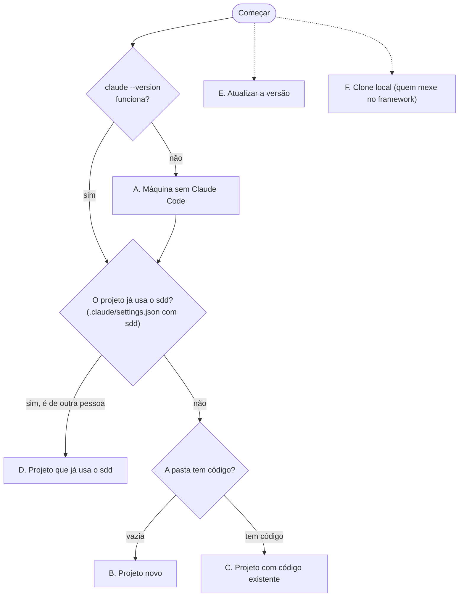

# Instalação

Como instalar o plugin **`sdd`** do Claude Code, do zero até o primeiro `/sdd:start`. Comandos conferidos na [documentação oficial](https://code.claude.com/docs/en/setup) em 2026-10-15.

## Em duas peças

| Peça | O que é | Quantas vezes |
|---|---|---|
| **Claude Code (CLI)** | O programa `claude` | 1 vez por máquina |
| **Marketplace `claude-sdd-framework`** | O catálogo (este repositório) de onde o plugin vem | 1 vez por máquina |
| **Plugin `sdd`** | O TechLead e o time de agentes | 1 vez **por projeto** |

## Em que situação você está?



| | Situação | Você faz | Tempo |
|---|---|---|---|
| **A** | Nunca usou o Claude Code nesta máquina | instalar o CLI, logar, conferir git | ~10 min |
| **B** | Projeto novo, pasta vazia | `git init`, registrar o marketplace, settings, plugin | ~5 min |
| **C** | Projeto com código existente | registrar o marketplace, settings, plugin | ~5 min |
| **D** | Colega já configurou o projeto; você clonou | registrar o marketplace, instalar o plugin | ~3 min |
| **E** | Já instalado, quer trocar de versão | trocar o `ref`, `add`, `update` | ~3 min |
| **F** | Você contribui com o framework | marketplace por caminho local | ~5 min |

> **Não sabe em qual está?** Rode o verificador (somente leitura) na pasta do projeto: ele diz o tipo, o que falta e o próximo passo.
>
> ```bash
> # macOS, Linux, Git Bash
> curl -fsSL https://raw.githubusercontent.com/powerlok/claude-sdd-framework/main/scripts/check-env.sh -o check-env.sh && bash check-env.sh --net
> ```
>
> ```powershell
> # Windows PowerShell
> irm https://raw.githubusercontent.com/powerlok/claude-sdd-framework/main/scripts/check-env.ps1 -OutFile check-env.ps1
> powershell -ExecutionPolicy Bypass -File .\check-env.ps1 -Net
> ```
>
> Leia o arquivo antes de rodar: ele só lê (não instala, não escreve, não usa `eval`). Com o repositório clonado: `bash scripts/check-env.sh` na pasta do projeto.

---

## A. Máquina sem Claude Code

**Requisitos:** macOS 13+, Windows 10 (1809+), Ubuntu 20.04+/Debian 10+/Alpine 3.19+, 4 GB de RAM, internet, e uma conta Claude (Pro, Max, Teams, Enterprise ou Console; o plano gratuito não inclui o Claude Code).

**A1. Instale o CLI** (instalador nativo, recomendado; não precisa de administrador nem de Node):

| Sistema | Comando |
|---|---|
| macOS, Linux, WSL | `curl -fsSL https://claude.ai/install.sh \| bash` |
| Windows PowerShell | `irm https://claude.ai/install.ps1 \| iex` |
| Windows CMD | `curl -fsSL https://claude.ai/install.cmd -o install.cmd && install.cmd && del install.cmd` |

Alternativas: `brew install --cask claude-code` (macOS), `winget install Anthropic.ClaudeCode` (Windows) ou `npm install -g @anthropic-ai/claude-code` (exige Node 22+; nunca com `sudo`). Atualizar o CLI: `claude update` (instalador nativo) ou o comando do gerenciador usado.

**A2. Confira.** Abra um terminal **novo** e rode:

```bash
claude --version
```

Você vê algo como `2.1.300 (Claude Code)`. O sdd exige **2.1.288 ou superior**. Se aparecer "comando não encontrado", o PATH não inclui a pasta do `claude`:

| Sistema | Onde está o binário | Corrigir o PATH |
|---|---|---|
| macOS, Linux | `~/.local/bin/claude` | `echo 'export PATH="$HOME/.local/bin:$PATH"' >> ~/.zshrc` (ou `~/.bashrc`); abra um terminal novo |
| Windows (PowerShell) | `%USERPROFILE%\.local\bin\claude.exe` | `$p = [Environment]::GetEnvironmentVariable('PATH','User'); [Environment]::SetEnvironmentVariable('PATH', "$p;$env:USERPROFILE\.local\bin", 'User')`; reinicie o terminal |
| Windows (só esta sessão) | | `$env:Path += ";$HOME\.local\bin"` (PowerShell) ou `export PATH="$PATH:$HOME/.local/bin"` (Git Bash) |

Terminal dentro de um editor (VS Code etc.) herda o PATH do editor: feche e reabra o editor. Para diagnóstico: `claude doctor`.

**A3. Faça login.** Rode `claude`; o navegador abre para entrar (se não abrir, tecle `c` para copiar a URL). Depois, `claude auth status` deve responder com a sua conta (sai com código 0 logado e 1 sem login).

**A4. Git.** O sdd precisa do `git` e, no Windows, do **Git Bash** (os hooks do plugin usam `bash`):

| Sistema | Instalar |
|---|---|
| Windows | [Git for Windows](https://git-scm.com/download/win) (traz o Git Bash); reabra o terminal; `bash --version` deve funcionar |
| macOS | `xcode-select --install` (ou `brew install git`) |
| Linux | `sudo apt install git` (ou o gerenciador da sua distro) |

No Windows com **WSL**, instale e rode tudo dentro do WSL (siga as linhas de Linux; o Git for Windows não é necessário lá).

**A5. Rede.** O Claude Code usa o git da máquina para baixar o marketplace. Confira (repositório público, sem credencial):

```bash
git ls-remote https://github.com/powerlok/claude-sdd-framework.git
```

Deve listar referências. Se falhar, o problema é proxy, firewall ou DNS bloqueando `github.com`. **Nunca** coloque usuário, senha ou token na URL.

Pronto. Siga para **B**, **C** ou **D** conforme o seu projeto.

---

## B. Projeto novo (pasta vazia)

**B1. Crie a pasta e o repositório:**

```bash
mkdir meu-projeto && cd meu-projeto && git init
```

**B2. Registre o marketplace** (uma vez por máquina; se já registrou antes, pule):

```bash
claude plugin marketplace list
claude plugin marketplace add "https://github.com/powerlok/claude-sdd-framework.git#v0.12.0"
```

O primeiro comando lista o que já existe. Se `claude-sdd-framework` já aparece **sem** `@v0.12.0`, veja [E](#e-atualizar-a-versão). Você vê `Successfully added marketplace: claude-sdd-framework`.

**B3. Copie o settings.** Copie o arquivo **inteiro** [`templates/project-settings.git.json`](../templates/project-settings.git.json) para `meu-projeto/.claude/settings.json` (crie a pasta `.claude`). Ele declara o marketplace e o plugin, define o TechLead como agente e traz as [proteções](referencia.md#proteções-do-template). Sozinho ele **não carrega** o plugin: falta o B4.

**B4. Instale o plugin** (na raiz do projeto):

```bash
claude plugin install sdd@claude-sdd-framework --scope project
claude plugin list
```

`sdd` aparece com escopo `project` e `enabled`.

**B5. Abra o Claude e inicie o fluxo:**

```bash
claude
```

Aceite o diálogo de confiança da pasta (sem confiar, o plugin do projeto não carrega). O Claude Code só responde depois da sua primeira mensagem: digite **`/sdd:start`**. O TechLead pergunta a stack e propõe o `CLAUDE.md`; nada é criado sem a sua confirmação. Depois, [faça o primeiro pedido](primeiros-passos.md).

---

## C. Projeto com código existente

Igual ao **B**, sem o `git init`. Na raiz do repositório do projeto:

**C1.** Registre o marketplace (uma vez por máquina), como em [B2](#b-projeto-novo-pasta-vazia).

**C2. Settings.** Copie o arquivo inteiro [`templates/project-settings.git.json`](../templates/project-settings.git.json) para `.claude/settings.json`.

**Já existe um `.claude/settings.json`?** Não sobrescreva: acrescente `extraKnownMarketplaces`, `enabledPlugins` e `agent` do modelo e una as listas `permissions.deny` e `permissions.ask` com as do modelo (nenhuma entrada sua é removida). Se você tem `permissions.allow` com `Bash(gh *)` ou `Bash(*)`, remova: um `allow` amplo anula as confirmações.

**C3. Plugin:**

```bash
claude plugin install sdd@claude-sdd-framework --scope project
claude plugin list
```

**C4.** `claude`, aceite a confiança da pasta e digite **`/sdd:start`**. O TechLead **lê o código** (README, manifestos, configs) e propõe o `CLAUDE.md` com comandos reais e `## Stack`.

---

## D. Projeto que já usa o sdd

O repositório já tem `.claude/settings.json` com o sdd (um colega configurou). Você só precisa do marketplace e do plugin **na sua máquina**:

```bash
git clone <url-do-projeto> && cd <projeto>
claude plugin marketplace add "https://github.com/powerlok/claude-sdd-framework.git#v0.12.0"
claude plugin install sdd@claude-sdd-framework --scope project
claude
```

Aceite a confiança da pasta. O `settings.json` do projeto só habilita o plugin; baixá-lo na sua máquina é o `install`. Sem ele, o `/plugin` mostra o erro "enabled in project settings but isn't installed".

---

## E. Atualizar a versão

Quem decide a versão na máquina é a entrada `claude-sdd-framework` do seu `~/.claude/settings.json` (Windows: `%USERPROFILE%\.claude\settings.json`). Para trocar de versão:

```bash
claude plugin marketplace list
```

| A lista mostra | Faça |
|---|---|
| `...git@v0.12.0` | Nada: já está na versão atual. |
| outra versão (`@v0.11.1`, `@v0.9.4`...) ou sem `@...` | Siga os passos abaixo. |

1. Edite `~/.claude/settings.json` e, em `extraKnownMarketplaces.claude-sdd-framework.source`, ponha o `ref` desejado:

   ```json
   "claude-sdd-framework": {
     "source": { "source": "git", "url": "https://github.com/powerlok/claude-sdd-framework.git", "ref": "v0.12.0" }
   }
   ```

2. Registre de novo com a **mesma** fonte, e atualize em cada projeto (na raiz dele):

   ```bash
   claude plugin marketplace add "https://github.com/powerlok/claude-sdd-framework.git#v0.12.0"
   claude plugin update sdd@claude-sdd-framework --scope project
   ```

3. Reinicie o `claude`. Confira: `claude plugin list` mostra a versão nova.

> **Evite `claude plugin marketplace remove`:** ele desinstala o plugin de todos os projetos e apaga a declaração dos `.claude/settings.json` deles. Evite também `marketplace update` logo depois de editar o `ref` à mão (o marketplace aparece como "not found" até o `add`).

Vindo de versão anterior à 0.11.0: troque `"agent": "sdd:tecleader"` por `"agent": "sdd:techlead"` no `.claude/settings.json` do projeto. O que mudou em cada versão: [CHANGELOG](../CHANGELOG.md).

---

## F. Clone local (quem mexe no framework)

Para testar alterações sem publicar:

1. Clone este repositório.
2. Use [`templates/project-settings.local.json`](../templates/project-settings.local.json) como `.claude/settings.json` do projeto de teste, trocando o placeholder pelo caminho do clone (com `/`).
3. Na raiz do projeto de teste:

   ```bash
   claude plugin marketplace add "<caminho>/claude-sdd-framework" --scope project
   claude plugin install sdd@claude-sdd-framework --scope project
   ```

Catálogo opcional `authoring` (criar skills e agentes): `claude plugin install authoring@claude-sdd-framework --scope project`.

---

## Problemas comuns

| Sintoma | Causa | Solução |
|---|---|---|
| `claude: command not found` | PATH sem `~/.local/bin` | [A2](#a-máquina-sem-claude-code) |
| `its source doesn't match its extraKnownMarketplaces entry` | O `add` usa uma fonte diferente da entrada do `~/.claude/settings.json` | [E](#e-atualizar-a-versão): use a **mesma** URL e `ref` |
| Clone do marketplace falha | Rede, proxy ou tag inexistente | `git ls-remote` ([A5](#a-máquina-sem-claude-code)); confira se a tag `v0.12.0` existe |
| `claude plugin list` mostra `sdd` **disabled** | Instalado, mas não habilitado neste projeto | `claude plugin enable sdd@claude-sdd-framework --scope project`; confira o `enabledPlugins` do `.claude/settings.json` |
| O `claude` abre, mas não responde como TechLead | `agent` ausente ou `sdd:tecleader` (removido na 0.11.0) | ponha `"agent": "sdd:techlead"` no `.claude/settings.json` e reabra |
| Abri o `claude` e nada acontece | O Claude Code só responde após a sua 1ª mensagem | digite `/sdd:start` |
| Hooks não rodam no Windows | Sem Git Bash (os hooks usam `bash`) | instale o Git for Windows ([A4](#a-máquina-sem-claude-code)) e reabra o terminal |
| O plugin do projeto não carrega | Pasta não confiada | aceite o diálogo de confiança ao abrir o `claude` |

Mais: [primeiros passos](primeiros-passos.md) · [referência](referencia.md) · [manual de uso](manual-de-uso.html).
